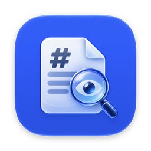
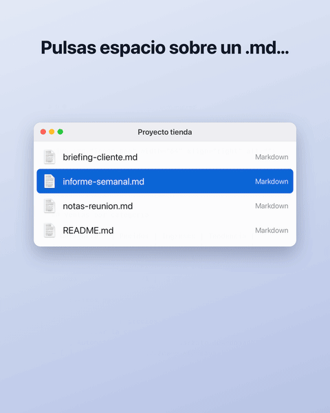

<p align="center"></p>

<h1 align="center">Vistazo MD</h1>

<p align="center"><strong>Pulsa espacio sobre un Markdown en Finder y léelo de verdad.</strong><br>
Vista rápida (Quick Look) y visor de ficheros <code>.md</code> para macOS, gratis y de código abierto.</p>

<p align="center">
  <a href="../../releases/latest"></a>
  
  <a href="LICENSE"></a>
</p>

<p align="center"><a href="README.md">Read in English</a></p>

<p align="center"></p>

## Por qué

Los README, las notas, la documentación y casi todo lo que generan los asistentes de IA llegan en Markdown. En el Mac, al pulsar espacio sobre uno de esos ficheros, ves texto plano lleno de `#`, `**` y `|---|`. Vistazo MD lo muestra como lo haría GitHub, dentro de la propia vista rápida.

## Qué hace

- **Markdown de GitHub (GFM):** títulos, tablas, listas de tareas, tachado, citas, enlaces e imágenes (remotas y locales, con rutas relativas al fichero).
- **Resaltado de sintaxis** en los bloques de código, con detección automática del lenguaje.
- **Modo claro y oscuro** según la apariencia del sistema.
- **Front matter YAML** mostrado como bloque discreto.
- **Seguro:** el HTML incrustado se limpia con DOMPurify, así que un `.md` no puede ejecutar código.
- **Sin conexión:** todo va dentro de la app; solo se descargan las imágenes remotas.
- **Visor con doble clic:** cada fichero se abre en su propia ventana (o pestaña) y **se recarga solo** cuando lo guardas desde cualquier editor, sin perder la posición.
- Zoom con ⌘+ / ⌘− / ⌘0 y recarga con ⌘R.
- Interfaz en español y en inglés.

Reconoce `.md`, `.markdown`, `.mdown`, `.mkd`, `.rmd`, `.qmd` y los tipos de Markdown de Typora, iA Writer, RStudio y Quarto.

## Instalación

Necesita macOS 14 Sonoma o posterior, en Apple Silicon o Intel.

### Con Homebrew

```bash
brew install davidcondelazaro/tap/vistazo-md
```

Después abre **Vistazo MD** una vez para que macOS registre la extensión de Quick Look. Y listo.

### Descarga manual

1. Descarga `VistazoMD-x.y.zip` desde [la última versión](../../releases/latest) y descomprímelo.
2. Mueve **Vistazo MD.app** a la carpeta Aplicaciones.
3. Ábrela. La primera vez, macOS dirá que no puede verificar la app (te explico por qué abajo). Ve a **Ajustes del Sistema → Privacidad y seguridad**, baja hasta el final y pulsa **Abrir igualmente**.
4. Ya está: selecciona cualquier `.md` en Finder y pulsa espacio.

<details>
<summary>¿Prefieres Terminal? Un comando en lugar del paso 3</summary>

```bash
xattr -dr com.apple.quarantine "/Applications/Vistazo MD.app"
```

</details>

### ¿Por qué macOS pide permiso?

Apple solo omite ese aviso en las apps **notarizadas**, y para notarizar hace falta una cuenta de Apple Developer de pago. Vistazo MD es un proyecto personal y gratuito: está firmada en local, pero no notarizada. Por lo demás:

- Todo el código fuente está en este repositorio.
- Las versiones publicadas las compila [GitHub Actions](.github/workflows/release.yml) directamente desde el código etiquetado.
- La app no se conecta a internet salvo para cargar las imágenes remotas que enlace un documento.
- Siempre puedes [compilarla tú](#compilar-desde-el-código).

Solo tienes que permitirla una vez.

## Trucos

**Abrir los `.md` con doble clic.** Abre la app sin ningún fichero y pulsa **Usar Vistazo MD como visor predeterminado**. O desde Finder: **Obtener información** sobre un `.md` → **Abrir con** → Vistazo MD → **Cambiar todo**.

**¿Ya tienes otro visor de Markdown?** macOS usa una sola extensión de Quick Look por tipo de fichero. Si tienes otra instalada (por ejemplo QLMarkdown), desactívala en **Ajustes del Sistema → General → Ítems de inicio y extensiones → Quick Look**. No hace falta desinstalarla.

## Compilar desde el código

Necesitas Xcode 26 o posterior (el icono usa el formato de Icon Composer) y [XcodeGen](https://github.com/yonaskolb/XcodeGen):

```bash
brew install xcodegen
./scripts/install.sh
```

`install.sh` genera el proyecto, compila, copia la app en `~/Applications` y registra la extensión. Para trabajar en Xcode, ejecuta `xcodegen generate` y abre `VistazoMD.xcodeproj`.

`./scripts/release.sh` crea el `.zip` universal en `dist/`.

## Cómo está hecho

| Parte | Qué es |
|-------|--------|
| `QuickLookExtension/` | La extensión de Quick Look: un `QLPreviewingController` con un `WKWebView` |
| `Shared/MarkdownPage.swift` | Construye la página HTML autocontenida que renderiza el Markdown |
| `Shared/Resources/` | marked, DOMPurify, highlight.js y la hoja de estilo de GitHub |
| `VistazoMD/` | La app: transporta la extensión y hace de visor (una ventana por fichero, recarga automática, bienvenida) |
| `VistazoMD/Localizable.xcstrings` | Los textos de la interfaz: inglés como base y traducción al español |
| `project.yml` | Definición del proyecto para XcodeGen (el `.xcodeproj` no se versiona) |

El Markdown se convierte a HTML dentro del propio WebView con JavaScript. Todo va incluido en la app y no se descarga nada de internet, salvo las imágenes remotas que enlace el documento.

## Sugerencias y errores

¿Algún fallo o echas algo en falta? [Abre una incidencia](../../issues). Si Vistazo MD te resulta útil, una ⭐ ayuda a que otros lo encuentren.

## Licencia

[MIT](LICENSE) © 2026 David Conde. Las librerías incluidas mantienen sus licencias: ver [THIRD_PARTY_NOTICES.md](THIRD_PARTY_NOTICES.md).
