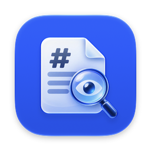
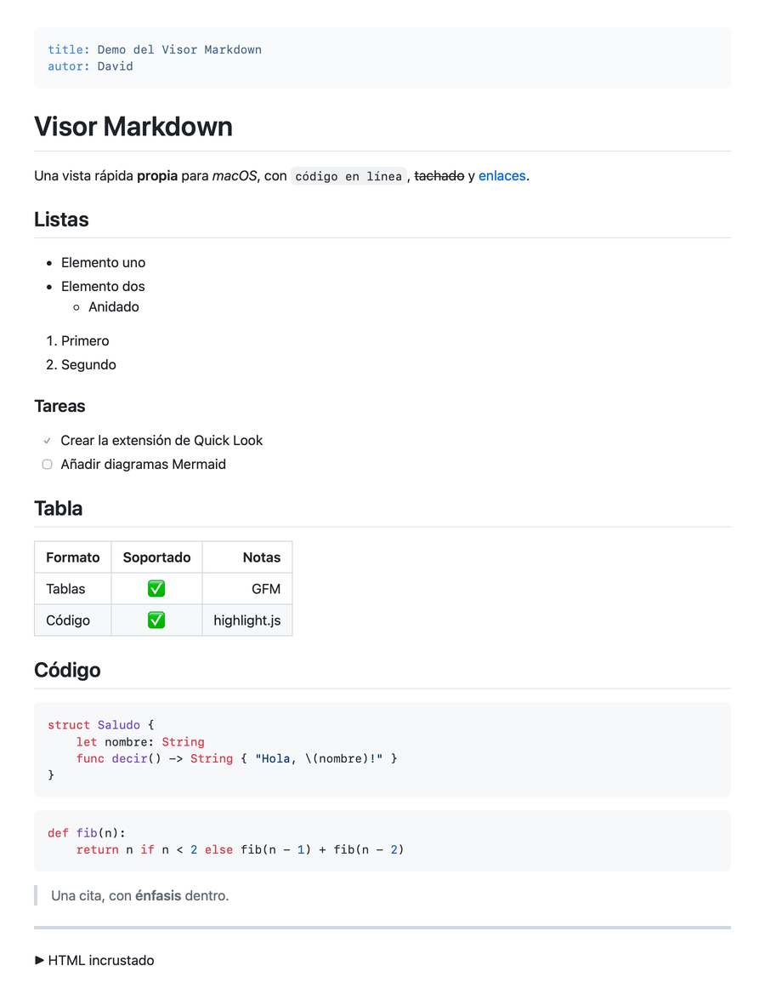
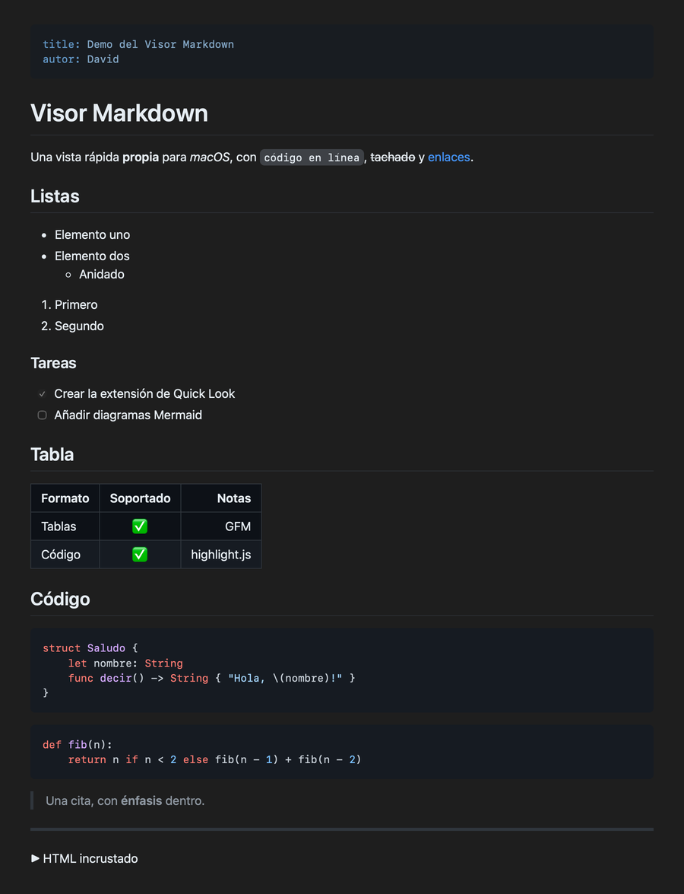

<p align="center"></p>

<h1 align="center">Vistazo MD</h1>

<p align="center">Vista rápida y visor de ficheros Markdown para macOS: selecciona un <code>.md</code> en Finder y pulsa la barra espaciadora, o ábrelo con doble clic.</p>

<p align="center">
  
  
</p>

## Qué hace

- **Markdown de GitHub (GFM):** títulos, listas, tablas, listas de tareas, tachado, citas, enlaces e imágenes (remotas y locales, con rutas relativas al fichero).
- **Resaltado de sintaxis** en los bloques de código, con detección automática del lenguaje.
- **Modo claro y oscuro** siguiendo la apariencia del sistema.
- **Front matter YAML** (`---` al inicio) mostrado como bloque discreto.
- **Seguro:** el HTML incrustado se limpia, así que un `.md` no puede ejecutar código.
- **Visor con doble clic:** cada fichero se abre en su propia ventana (o pestaña) y **se recarga solo** cuando lo guardas desde otro editor, sin perder la posición.
- Zoom con ⌘+ / ⌘− / ⌘0 y recarga manual con ⌘R.

Reconoce `.md`, `.markdown`, `.mdown`, `.mkd`, `.rmd`, `.qmd` y los tipos de Markdown de Typora, iA Writer, RStudio y Quarto.

## Instalación

1. Descarga `VistazoMD-x.y.zip` desde [Releases](../../releases) y descomprímelo.
2. Mueve **Vistazo MD.app** a la carpeta Aplicaciones.
3. La app no está notarizada por Apple (es un proyecto personal sin cuenta de Apple Developer), así que macOS la bloqueará la primera vez. Para permitirla, elige una de estas dos opciones:
   - Intenta abrirla, ve a **Ajustes del Sistema → Privacidad y seguridad** y pulsa **Abrir igualmente**.
   - O ejecuta en Terminal:
     ```bash
     xattr -dr com.apple.quarantine "/Applications/Vistazo MD.app"
     ```
4. Abre la app una vez: así macOS registra la extensión de Quick Look.

Requiere macOS 14 Sonoma o posterior, en Apple Silicon o Intel.

### Abrir los .md con doble clic

Abre la app sin ningún fichero y pulsa **Usar Vistazo MD como visor predeterminado**. También puedes hacerlo desde Finder: **Obtener información** sobre un `.md` → **Abrir con** → Vistazo MD → **Cambiar todo**.

### Si ya tienes otro visor de Markdown

macOS usa una sola extensión de Quick Look por tipo de fichero. Si tienes otra instalada (por ejemplo QLMarkdown), desactívala en **Ajustes del Sistema → General → Ítems de inicio y extensiones → Quick Look**. No hace falta desinstalarla.

## Compilar desde el código

Necesitas Xcode 26 o posterior (el icono usa el formato de Icon Composer) y [XcodeGen](https://github.com/yonaskolb/XcodeGen):

```bash
brew install xcodegen
./scripts/install.sh
```

`install.sh` genera el proyecto, compila, copia la app en `~/Applications` y registra la extensión. Para trabajar en Xcode, ejecuta `xcodegen generate` y abre `VistazoMD.xcodeproj`.

`./scripts/release.sh` crea el `.zip` universal en `dist/`.

## Cómo está hecho

| Parte | Qué es |
|-------|--------|
| `QuickLookExtension/` | La extensión de Quick Look: un `QLPreviewingController` con un `WKWebView` |
| `Shared/MarkdownPage.swift` | Construye la página HTML autocontenida que renderiza el Markdown |
| `Shared/Resources/` | marked, DOMPurify, highlight.js y la hoja de estilo de GitHub |
| `VistazoMD/` | La app: transporta la extensión y hace de visor (una ventana por fichero, recarga automática, bienvenida) |
| `project.yml` | Definición del proyecto para XcodeGen (el `.xcodeproj` no se versiona) |

El Markdown se convierte a HTML dentro del propio WebView con JavaScript. Todo va incluido en la app y no se descarga nada de internet, salvo las imágenes remotas que enlace el documento.

## Licencia

[MIT](LICENSE) © 2026 David Conde. Las librerías incluidas mantienen sus licencias: ver [THIRD_PARTY_NOTICES.md](THIRD_PARTY_NOTICES.md).
