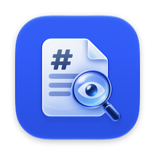
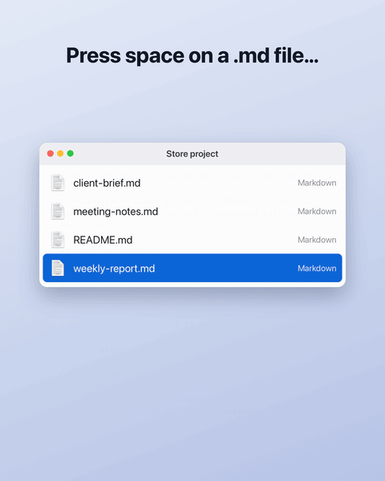

<p align="center"></p>

<h1 align="center">Vistazo MD</h1>

<p align="center"><strong>Press space on a Markdown file in Finder and actually read it.</strong><br>
A free, open-source Quick Look preview and viewer for <code>.md</code> files on macOS.</p>

<p align="center">
  <a href="../../releases/latest"></a>
  
  <a href="LICENSE"></a>
</p>

<p align="center"><a href="README.es.md">Leer en español</a></p>

<p align="center"></p>

## Why

READMEs, notes, docs and almost everything AI assistants produce come as Markdown. On a Mac, pressing space on one of those files shows plain text full of `#`, `**` and `|---|`. Vistazo MD renders it the way GitHub does, right inside Quick Look.

## Features

- **GitHub Flavored Markdown:** headings, tables, task lists, strikethrough, quotes, links and images (remote and local, with paths relative to the file).
- **Syntax highlighting** in code blocks, with automatic language detection.
- **Light and dark mode**, following your system appearance.
- **YAML front matter** shown as a discreet block.
- **Safe:** embedded HTML is sanitized with DOMPurify, so a `.md` file can't run code.
- **Works offline:** everything is bundled in the app; only remote images are downloaded.
- **Double-click viewer:** each file opens in its own window (or tab) and **reloads automatically** when you save it from any editor, keeping your scroll position.
- Zoom with ⌘+ / ⌘− / ⌘0 and reload with ⌘R.
- English and Spanish interface.

Recognizes `.md`, `.markdown`, `.mdown`, `.mkd`, `.rmd`, `.qmd` and the Markdown types used by Typora, iA Writer, RStudio and Quarto.

## Install

Requires macOS 14 Sonoma or later, on Apple Silicon or Intel.

### With Homebrew

```bash
brew install davidcondelazaro/tap/vistazo-md
```

Then open **Vistazo MD** once so macOS registers the Quick Look extension. That's it.

### Manual download

1. Download `VistazoMD-x.y.zip` from [the latest release](../../releases/latest) and unzip it.
2. Move **Vistazo MD.app** to your Applications folder.
3. Open it. The first time, macOS will say it can't verify the app (see below). Go to **System Settings → Privacy & Security**, scroll down and click **Open Anyway**.
4. Done: select any `.md` file in Finder and press space.

<details>
<summary>Prefer Terminal? One command instead of step 3</summary>

```bash
xattr -dr com.apple.quarantine "/Applications/Vistazo MD.app"
```

</details>

### Why does macOS ask for permission?

Apple only skips that warning for apps that are **notarized**, which requires a paid Apple Developer account. Vistazo MD is a free personal project, so it's signed locally but not notarized. Nothing else changes:

- The whole source code is in this repository.
- Release builds are compiled by [GitHub Actions](.github/workflows/release.yml) straight from the tagged source.
- The app doesn't connect to the internet except to load remote images that a document links to.
- You can always [build it yourself](#build-from-source).

You only need to allow it once.

## Tips

**Open `.md` files with a double-click.** Open the app with no file and click **Use Vistazo MD as Default Viewer**. Or in Finder: **Get Info** on a `.md` file → **Open with** → Vistazo MD → **Change All**.

**Already have another Markdown previewer?** macOS uses one Quick Look extension per file type. If you have another one installed (QLMarkdown, for example), turn it off in **System Settings → General → Login Items & Extensions → Quick Look**. No need to uninstall it.

## Build from source

You need Xcode 26 or later (the icon uses the Icon Composer format) and [XcodeGen](https://github.com/yonaskolb/XcodeGen):

```bash
brew install xcodegen
./scripts/install.sh
```

`install.sh` generates the project, builds it, copies the app to `~/Applications` and registers the extension. To work in Xcode, run `xcodegen generate` and open `VistazoMD.xcodeproj`.

`./scripts/release.sh` creates the universal `.zip` in `dist/`.

## How it's built

| Part | What it is |
|------|------------|
| `QuickLookExtension/` | The Quick Look extension: a `QLPreviewingController` with a `WKWebView` |
| `Shared/MarkdownPage.swift` | Builds the self-contained HTML page that renders the Markdown |
| `Shared/Resources/` | marked, DOMPurify, highlight.js and GitHub's stylesheet |
| `VistazoMD/` | The app: ships the extension and works as a viewer (one window per file, auto-reload, welcome screen) |
| `VistazoMD/Localizable.xcstrings` | Interface strings: English as the base language, with a Spanish translation |
| `project.yml` | XcodeGen project definition (the `.xcodeproj` isn't versioned) |

Markdown is converted to HTML inside the WebView with JavaScript. Everything is bundled in the app and nothing is downloaded, except remote images linked from the document.

## Feedback

Found a bug or missing something? [Open an issue](../../issues). If Vistazo MD is useful to you, a ⭐ helps other people find it.

## License

[MIT](LICENSE) © 2026 David Conde. Bundled libraries keep their own licenses: see [THIRD_PARTY_NOTICES.md](THIRD_PARTY_NOTICES.md).
